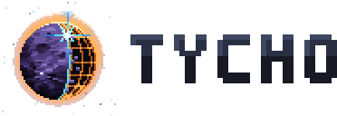

<!-- logo -->
<p align="center">
  <picture>
    <source media="(prefers-color-scheme: dark)" srcset="docs/brand/tycho-lockup.svg">
    
  </picture>
</p>
<!-- /logo -->

# Tycho

An engine and a shelf of game features for small, phone-first pixel games in the browser, with Tyrell, a minds engine for games full of people, inside it. A game brings its content (places, art recipes, numbers, words) and its rules; Tycho brings everything that would otherwise be written a fourth time.

It's TypeScript, built into plain JavaScript that a game loads with script tags: no build step in the game, nothing to install, no modules. Three games run on it: [Under the White Dragon](https://github.com/doctorallen/under-the-white-dragon), [Lodestar](https://github.com/doctorallen/lodestar) and [Merryfolk](https://github.com/doctorallen/merryfolk).

## Three outputs, one version

| File | Global | What it is |
|---|---|---|
| `dist/tycho.js` | `Tycho` | The engine: seeds, colors and the loop; the renderer, sprites, painting and effects; grids, collision, movers and paths; controls, items and guides; saving, the installable app, dev flags and the dev drawer, loading, sound, the minds inspector and the interface kit |
| `dist/tyrell.js` | `Tyrell` | The minds engine: people with needs, routines, plans, feelings, memories and relationships, with time walk. See [tyrell/README.md](tyrell/README.md) |
| `dist/tycho-minds.js` | `TychoMinds` (and `Tycho.minds`) | The bridge between them: Tyrell's clock from the game's, the minds in the save, seats, travel times, who might be on screen, who saw what, and harm handed between Tycho.harm and Morgul. See [docs/minds.md](docs/minds.md) |

Each is also built as an ES module (`.mjs`) and for Node's require (`.cjs`), with types (`.d.ts`, and `.global.d.ts` for the global). Beside them, `dist/tycho-sw.js` is the service worker an installable game imports, and `dist/testkit.cjs` the Node test kit. A game without people (Lodestar) loads `tycho.js` alone.

## Using it in a game

```sh
git submodule add https://github.com/doctorallen/tycho vendor/tycho
```

```html
<script src="vendor/tycho/dist/tycho.js"></script>
<script src="vendor/tycho/dist/tyrell.js"></script>        <!-- a game with people -->
<script src="vendor/tycho/dist/tycho-minds.js"></script>  <!-- and the bridge -->
<script src="js/util.js"></script>                        <!-- then the game's own -->
```

Then name what you use once, near the top of the game's first script:

```js
const { hash, noise, Rng } = Tycho.seed;
const { clamp, lerp } = Tycho.math;
```

If the game deploys from CI, its checkout needs `submodules: true` and its site needs the `dist/` files it loads. Each game pins the Tycho commit it was tested with; to update, `git -C vendor/tycho pull`, run the game's tests, and commit the new pointer.

An installable game keeps a tiny `sw.js` at its root that imports Tycho's worker:

```js
self.TYCHO_SW = { name: 'mygame', build: '__BUILD__' }; // the deploy stamps the build
importScripts('vendor/tycho/dist/tycho-sw.js');
```

## The parts

The engine comes in layers, each using only those below it (`scripts/layers.mjs` checks this on every build), so a game can take the core and the pixels without the rest:

| Layer | Parts | State |
|---|---|---|
| Core | `seed` (hashes, value noise, seeded streams), `math`, `color` (mixing, shading, painter's ramps), `loop` (fixed steps, frame samples, the quality governor) | In |
| Pixels | `gpu` (the frame on the GPU: a batcher standing in for the 2D canvas, an atlas, the ground's textures, bloom), `light` (the smooth model), `post` (the blur finish: bloom, reflections, fade), `sprite` (canvases, letter-row sprites, outlines, copies, letter grids enlarged by rule, sprites painted from shapes), `paint` (the chunked lazy painter: a pixel buffer, flat or stroked, operations with their own seeds, the chunk cache), `fx` (particles, effects that run out, rising words); then figure, life, sky | Partly in |
| World | `grid` (tile layers in chunks, changes from the seed), `collide` (one query over shapes and tiles), `move` (a platform runner, a top-down body), `path` (flow fields, A*, routes over places); then gen, liquid, tilelight | Partly in |
| Play | `input` (the controls: a stick, buttons and keys holding actions, presses taken once, edges, a test's bot, blocking and the tap guard; drag, pinch and tap for maps), `items` (bags by count, things of their own, slots, gear, counted views), `guide` (a tutorial's steps), `harm` (the moment of a hit: a pipeline of stages, statuses and reactions, means, moves, triggers, the feel, the player's wounds); then interact, craft, trade, build, mine | Partly in |
| Shell | `save` (storage that never throws, a save store with renames and starting over), `pwa` (staying current, installing), `dev` (flags, notes, the dev drawer), `loader` (loading in slices), `audio` (sound made in code: the engine, the voices, a bank rendered ahead, the music's machinery), `inspect` (the minds inspector for a game on Tyrell), `ui` (toasts, lines rising over the world, buttons wired by data attributes, a screen's acts); then hud, map | Partly in |

The move of the three games onto Tycho was planned in [the Tycho plan](https://claude.ai/artifact/NrDPrQpmBQpjMmQPUEAgWu) and is recorded in [docs/move.md](docs/move.md), with what's next. [docs/](docs/README.md) has a page for each part that's in, and [docs/brand](docs/brand/README.md) the logo; the docs, Tyrell's too, are also a site at [doctorallen.github.io/tycho](https://doctorallen.github.io/tycho/), built from the same files.

Two rules hold everywhere:

- **Parameters, not defaults.** Whatever makes a game look or play its own way is passed in. A new default never changes an old game.
- **Determinism.** Anything generated or painted draws from `Tycho.seed`, never `Math.random`, `Date.now` or anything outside its inputs, so a seed always makes the same world and the same picture. `Tycho.seed.fxRand` is for sparkle nobody saves.

## Tyrell inside, kept apart

Tyrell lives in [tyrell/](tyrell/) with its history, its docs, its sample town (Rocinante) and its Voight-Kampff runs, and keeps its own rules: plain-data state, every outside change recorded, the same seed giving the same world, nothing touching the browser, all of it testable in Node. Nothing in `tyrell/src` may import from the engine. Tyrell owns minds and has no coordinates; the engine owns space, pixels and the screen and has no minds; the bridge joins them.

[Eros](docs/eros.md) (`eros/`, `npm run eros`) is a sandbox in the terminal for Tyrell, for the people making the games: it runs a town live (Rocinante, or any setup file), tells its story with every one of Irulan's settings, shows everything the town is made of to see, add and change (each change runs the town again to the same moment, and shows what it did), keeps the living documentation of every kind of thing a town can declare, generated from Tyrell's source, and opens and exports setup files. It has its own dependencies (Ink and React) and isn't part of `dist/`.

## Building and testing

```sh
npm install            # TypeScript and esbuild (pinned), for building only
npm run build          # every output into dist/ (commit dist/ with any change to the sources)
npm test               # builds, then the engine's and Tyrell's suites
npm run typecheck
npm run test:browser   # the pixels' canvas work and the sound in Chromium, against the games' originals (needs Playwright or puppeteer-core)
npm run vk             # Voight-Kampff: a week of Rocinante
npm run eros           # Eros, the sandbox: a town live in the terminal, its story, its parts, the living docs
npm run test:eros      # Eros's type-check and tests
```

CI also runs every game's own tests with the new build in its `vendor/tycho`.

## License

MIT. See [LICENSE](LICENSE).
