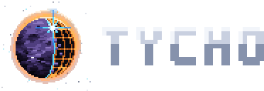

# The logo

A world being built. The Tycho moon is half made: its finished side is amethyst rock, cratered, with the young Tycho crater's rays thrown across it; the rest is still an orange lattice of latitude and longitude; an orange ring of light burns round it all; and a blue star at the build front welds the seam. It's what the engine is for, worlds put together piece by piece, painted the way Lodestar is: surfaces in short strokes of close tones by how lit they are, light that glows in stepped bands, motes in the dark.

## The files

| File | What it is |
|---|---|
| [tycho-mark.svg](tycho-mark.svg) | The mark alone, 64 × 64 pixels, on a transparent ground |
| [tycho-512.png](tycho-512.png) | The mark at 512 pixels on the night ground, for an app icon or a social card |
| [tycho-wordmark.svg](tycho-wordmark.svg) | TYCHO in its pixel face, for a dark ground |
| [tycho-wordmark-dark.svg](tycho-wordmark-dark.svg) | The same for a light ground |
| [tycho-lockup.svg](tycho-lockup.svg) | The mark and the wordmark together, for a dark ground |
| [tycho-lockup-on-light.svg](tycho-lockup-on-light.svg) | The same for a light ground |

Every file is pixel art drawn as rectangles with crisp edges: scale it by whole numbers (2×, 3×, 4×) and it stays sharp. The mark is made to sit on dark; on light it keeps its glow, but the ring reads best against the night.

## Its colors

| | |
|---|---|
| The made world | amethyst rock, `#07050d` to `#ddd2f4` |
| The lattice and the ring | orange, `#b4581c`, `#ff7a1f`, `#ffb24a`, `#ffe9c2` |
| The star | blue, `#1f8cff`, `#55dcff`, `#c8f4ff`, with a white core |
| The night | `#05060a` |

## Drawing it again

`python3 docs/brand/make.py` (with numpy and Pillow) draws every file here from code: the painter, the world, the lattice, the ring, the star and the wordmark. Every choice in it is seeded, so it draws the same each time; change a color or a seed there and run it again.
