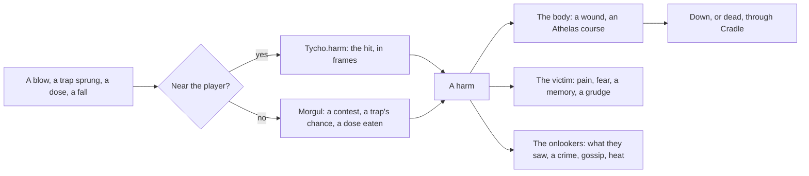

# Harm (proposed)

**Proposed: nothing on this page is built yet.** It's the design for people and creatures hurting each other in games on Tycho: fights, weapons, spells, traps, poison, falls, fire, and accidents nobody meant. Its open questions are settled ([what's decided](#whats-decided)); the code comes next, in [this order](#the-order-to-build-it).

The ideas come from Lodestar's own fighting (a hit that passes through resistances, armor, wards and statuses that react together, and hazards shown before they bite), RimWorld (wounds that need tending, infections, social fights that turn into brawls), Dwarf Fortress (grudges and vengeance that outlive the fight), Thief and Dishonored (traps and poison as the patient way to hurt someone, and accidents arranged to look like nothing), and Crusader Kings (murder by scheme, suspicion that falls on whoever had reason).

- [The idea](#the-idea)
- [A harm](#a-harm)
- [The act and the harm](#the-act-and-the-harm)
- [Tycho: the moment](#tycho-the-moment)
- [Tyrell: what follows](#tyrell-what-follows)
- [Athelas, grown](#athelas-grown)
- [On screen and off](#on-screen-and-off)
- [Each game](#each-game)
- [What's decided](#whats-decided)
- [The order to build it](#the-order-to-build-it)

## The idea

Every kind of physical harm is the same thing whatever caused it, and the work splits by how fast it happens.

- **Tycho handles the moment**, in frames: a swing's wind-up, the hit passing through the target's defenses, the knockback, the flash, the number, a trap's jaws closing on whoever stepped in. It's a part of the engine's play layer, `Tycho.harm`, and it knows nothing of minds.
- **Tyrell handles what follows**, in minutes, on screen and off: the wound and how long it takes to heal, the pain and the fear, the grudge and the revenge, who saw it, who's blamed, the watch, the gossip, the funeral. It's a new Tyrell module, Morgul (after the Morgul-blade, whose wound won't heal), on [Athelas](../tyrell/docs/modules/athelas.md), [Reverie](../tyrell/docs/modules/reverie.md), [Fellowship](../tyrell/docs/modules/fellowship.md), [Wormtongue](../tyrell/docs/modules/wormtongue.md), [Bree](../tyrell/docs/modules/bree.md) and [Cradle](../tyrell/docs/modules/cradle.md), with [the bridge](minds.md) between it and the game.
- **The game decides what harm there is**: its kinds of harm, whether anything has a health bar, which wound each harm leaves, how it looks, whether anyone can die, and whether the player can be hurt at all.

Both halves end in one record, a harm. Tycho's part makes one on screen; Morgul makes one off screen; from there on everything is shared.



## A harm

| Field | Meaning |
|---|---|
| `to` | Who it struck |
| `by` | Who did it: a person, `'player'`, or nobody (a rockfall) |
| `kind` | The game's own: `blunt`, `cut`, `burn`, `shock`, `poison`... |
| `severity` | 0..1, how bad, on the same scale as Wormtongue's crimes: a slap 0.05, a beating 0.5, a killing blow 1. A game with a health bar gives the share of it the hit took |
| `via` | How it came: `blow`, `trap`, `dose`, `fall`, `fire`, `area`... the game's |
| `intent` | `meant`, `defense`, `careless` or `accident` |
| `cause` | The hazard it came from, if it came from one (a trap, a tainted pot) |
| `what` | What it was done with: a good (a knife, a cudgel), a trap's kind |
| `place` | Where |
| `seenBy` | Who saw it land: from the game's sight on screen (`Tycho.minds.witnesses`), everyone at the place off screen |

A health bar is one game's fast pool, not the measure of harm. The general case is the wound it leaves, a condition that runs its course, so a game with no health still has harm: a shock from a rigged machine can leave someone with shaking hands for an hour. That goes for the player too: harm to the player leaves wounds, not a health bar (Lodestar's Kindler keeps his light, which is his health already).

## The act and the harm

A fight is the plain case: the act and the harm are one moment, and anyone near sees both. Everything else puts a gap between them, and the gap is what makes blame, wrong blame, warnings and revenge possible.

| | The act | The harm | Who sees what |
|---|---|---|---|
| A fight | the blow | at once | whoever is near sees both |
| A trap | setting it, earlier | whoever trips it, later | the setting and the springing have different witnesses; it can catch the wrong person |
| Poison | dosing food or drink | a course that starts hours later | nobody sees the harm as harm: it looks like an illness until someone works it out |
| An accident | nothing, or a neglect (a rotten stair left unmended) | a fall, a fire, a machine | nobody to blame, or whoever let it happen |

So the act and the harm are two records, linked by the `cause`. Setting a trap or dosing a pot is a deed the game reports like any other (`world.sense`), seen by whoever is there then; the harm comes later and is seen by whoever is there then. Blame is a belief (Reverie's, which can be wrong): who saw the act knows; who saw only the harm suspects.

## Tycho: the moment

`Tycho.harm`, in the play layer. Like every part it's parameters, not defaults: the game passes its stages, statuses, reactions and numbers, and every random draw comes from the source it's given. Lodestar's fighting (`hurtEnemy`, `hurtPlayer` and `killEnemy` in `combat.js`, its reactions, natures, affixes and hazards) already does all of this in its own code, so it moves in first and bit for bit: Lodestar plays the same, held to its traces, and that's the proof the part is general.

### The hit

A pipeline of stages the game lists in order. A stage takes the blow and the body it's landing on and may change the amount, stop it, mark it (a reaction's name to show), or send a follow-up blow to someone else (a shock that arcs, a chain that shares the hit).

```js
const hit = new Tycho.harm.Pipeline([
  Tycho.harm.resist({ of: elementMult }),       // weak, resistant or neither, by kind
  Tycho.harm.armor({ k: T.items.armorK }),      // k / (k + armor)
  Tycho.harm.soak('ward', { gone: wardGone }),  // a shield takes it first
  affixStage,                                   // the game's own: a shell, thorns, a chain
  Tycho.harm.react(REACTIONS),                  // statuses that meet: shatter, steam, pyre
]);
const r = hit.land(foe, { by: kindler, amount: 12, kinds: ['ember'], knock: { x, y }, heavy: true }, { rng: d.rng });
// r: { amount, stopped, verdict, marks, follow, knock, stagger, stop }
```

### Means: weapons, spells, poisons, traps

What harm is done with is declared once, as a means, and the player and the characters wield the same ones.

```js
const MEANS = [
  { id: 'cudgel', kinds: ['blunt'], use: 'strike', severity: 0.2,
    move: { windup: 0.35, active: 0.1, recover: 0.45, area: { ahead: 14, w: 16, h: 12 } }, blow: { amount: 8, knock: 120 } },
  { id: 'arc', kinds: ['shock'], use: 'cast', cost: { cooldown: 0.6 }, severity: 0.15,
    move: { windup: 0.1, bolt: { speed: 260, range: 120 } }, blow: { amount: 6, statuses: ['shock'] } },
  { id: 'nightshade', kinds: ['poison'], use: 'dose', course: 'nightshade' },
  { id: 'snare', kinds: ['cut'], use: 'set', severity: 0.25, trigger: { box: [12, 4], once: true, hidden: true }, blow: { amount: 5 } },
];
Tycho.minds.means(world, MEANS);   // declared to Tycho.harm and to Morgul alike
```

A means is used one of a few ways:

- **`strike`**: a move up close (a fist, a knife, a cudgel);
- **`throw`** and **`shoot`**: a projectile (a stone, a dart, a bolt);
- **`cast`**: a spell, a move with a cost: a cooldown, a charge, or a pool the game names (mana, light). Lodestar's rig and its spells are the first;
- **`coat`**: onto another means, so its blows carry this one's status or course for a few uses (a poisoned blade);
- **`dose`**: into food or drink, a [taint](#poison);
- **`set`**: a [trap](#traps), a trigger in space here and a hazard in Morgul.

The on-screen fields (the move, the blow, the trigger) are what `Tycho.harm` plays in frames; the off-screen ones (the kinds, `severity`, `course`) are what Morgul settles by numbers. The player wields a means as gear (`Tycho.items`: a thing in a slot, with the means as its own), or the game's own way (Lodestar's rig); a character holds it as a Ceres good of the same id, which they can buy, carry, be given and use up, and which Morgul reads (`armed`, a fight's odds, `has:nightshade` before a poisoning). So a character holding a cudgel strikes with its move on screen and its severity off screen.

### Statuses

What a hit leaves on a body for a while: a burn, a chill, a charge building to overload, a poison ticking. Each is declared with its time, how often it bites (`every`), how much, how it stacks, and whether it spreads (on a death, or on a hit). Two statuses that meet react, from a table the game gives (Lodestar's eight reactions and five stacks are the first).

### Moves

An attack is a timeline: a wind-up (the tell), the strike (the frames it can hit, and the area it covers, ahead of the body), the recovery (the opening). A strike hits each target once a swing. A solid hit during a wind-up breaks it off (a flinch); a heavy one staggers; a body marked steady shrugs both off. Lodestar's foes' wind-up, lunge and recover are the first, and the same moves serve people who fight on screen.

### Triggers

Harm that waits in space: a trap, a vent, a cloud. A trigger has a zone (a box, a line for a tripwire), what sets it off (a body entering it, or a cycle), whether it's armed, who set it, whether it's hidden, and the blow it lands. A cycle shows before it bites: Lodestar's vents glow and then burst, its spore pods swell and then let go. A snare is a zone entered once; a tripwire a line; a gas trap a zone that leaves a cloud behind.

### The player's wounds

The player isn't one of Tyrell's people (to Tyrell the player is `'player'`, someone who does things), so Athelas doesn't hold the player's wounds: `Tycho.harm` does, as conditions that run on the game's clock in game minutes, in phases shaped like Athelas's (sore for an hour, then stiff for a day). The game reads them for what they change (`has(player, 'shaky')` makes bench work rougher; a sprain slows the stick's pace) and keeps them in its own save. One wound table declares both: the bridge gives Athelas the course for characters and `Tycho.harm` the condition for the player. At its worst the player is knocked down, and the game says what that costs (time, money, what they were carrying); the player never dies of harm unless a game allows it.

### The feel

The world holds still a moment as a hit lands (longer for the one struck, longer for a heavy hit); knockback scaled by each body's own weight; a flash in the hit's color; the number rising (`Tycho.fx`); a shake for games that want one.

## Tyrell: what follows

Morgul, a Tyrell module. It's inert until the game declares a wound: a world with no harm saves and hashes as if Morgul were off. All its state is plain JSON in `world.s.mod.morgul`; everything from outside is an input, so time walk records it, and a poisoning rewinds like anything else.

### Wounds

The game maps harm to wounds: by kind and by how severe, the first that fits.

```js
const M = world.morgul;
M.wound({ id: 'bruised', kinds: ['blunt'], at: [0, 0.3], course: 'bruised' });
M.wound({ id: 'beaten', kinds: ['blunt'], at: [0.3, 1], course: 'beaten' });
M.wound({ id: 'cut', kinds: ['cut'], course: 'cut' });   // festers if nobody tends it
M.wound({ id: 'nightshade', kinds: ['poison'], what: 'nightshade', course: 'nightshade' });
```

A wound is an Athelas course carrying the harm's severity: it runs its phases (sore, then stiff, then healed), changes what they need and can do while it lasts, and heals in its own time. Someone's `hurt` is the sum of their open wounds' severities, easing as each heals: two beatings in a day are worse than one.

### Down and dead

At `downAt` (0.8) hurt they go down: they stop, can do nothing, and lie there until someone helps them up or it passes. At 1 they may die, as often as the `lethality` knob says (0 by default: nobody dies of harm unless the game says so): a departure through Cradle (`depart(id, 'killed')`), with grief for those who loved them, inheritance, and the one who did it remembered by everyone who knew.

### The victim

- **Feelings**, through Reverie: pain while the wound lasts, fear or anger by their temper, shaken for a while after.
- **A memory** of it, as important as it was severe, with who did it if they know.
- **What they believe**: who did it, as seen if they saw it, else suspected (below).
- **A grudge** against whoever did it, through Bree, by the severity and the intent: little for an accident, none for a blow they started themselves. A harm between two households can set them feuding.
- **Fear of them** (a sentiment): they keep out of the way, give way, or stay home.
- **Fear of the place**: a place where they were hurt, or where they believe a trap is, weighs less for a while (the `caution` knob).

### Onlookers and the law

Whoever saw it believes it (`did:<who>:harm`), remembers it, thinks less of whoever did it, and may step in. A harm the game declares a crime (meant harm as `assault`, a killing as `murder`, careless harm as `negligence`) goes to Wormtongue with its severity: reports to the watch, heat for the player, infamy, and gossip that carries it to people who never saw it. Self-defense isn't a crime.

### Traps

A hazard is something set at a place that will harm whoever it catches.

```js
M.trap({ id: 'snare', severity: 0.25, kind: 'cut', hidden: true, uses: 1, catch: 0.3 });
world.action({ id: 'set_snare', at: 'tag:path', minutes: 20, tags: ['harm'], if: ['has:snare'], then: ['take:snare', 'set:snare'] });
```

`set:<trap>` sets one where they are, with them as its setter and, in a task with a target, that target as who it's for. Off screen it catches people who come to or do something at its place, with its `catch` chance (less for someone careful, none for someone who knows it's there); one set for someone catches only them (a snare on their own gate). On screen the game draws it as a trigger and says when it springs. Whoever saw it set knows it's there: they may warn whoever it's for, disarm it, or keep quiet; gossip carries it.

### Poison

A taint goes into a place's stock (Ceres) or into someone's food:

```js
M.taint({ place: 'stall', item: 'noodles', n: 3, course: 'nightshade', by: 'vey' });
```

Tainted servings travel with the goods: bought, they go home with the buyer (the pantry keeps the count); used or eaten on the spot, they afflict whoever eats them. The poison's course starts quiet (a phase nobody notices), then shows (a phase that `tells`), and that's when the questions start. A poisoner can aim at one person (the meal they'll eat), or not care who.

### Suspicion

When a harm is seen, whoever saw it knows who did it. When it isn't (a trap sprung, a poison that tells, a body found), suspicion falls where people have reason to put it: whoever set or served it if anyone saw that; whoever bore the victim a grudge (Bree's `animosity`); whoever was about. Each is a belief, as strong as the evidence, and it can be wrong. A scapegoat can be blamed and hated for a harm someone else did, and gossip spreads the wrong name as readily as the right one. Nobody investigates: suspicion is all there is, and working out the truth is the player's to do.

### Fights by numbers

Off screen, a Bree fight comes out by a contest. Each turn of it, one of them lands a blow, by the odds of their `might` (the game's considerations: strength, size, skill, nerve, what they're holding: a [means](#means-weapons-spells-poisons-traps), by its `severity`) and how hurt each already is. A fight ends as Bree's do, by someone stepping in or someone walking off, and two more ways: someone yields (hurt past `yieldAt`, sooner for the timid), or someone goes down. Everything above then follows from each blow.

### Choosing harm

Harm is chosen like anything else. The game declares the actions (attacking, ambushing, setting a trap, poisoning, fleeing, hiding, tending the hurt, calling the watch) and Morgul adds what to weigh them by:

- terms: `hurt`, `wounded:<kind>`, `hurt_by:<id>`, `afraid_of:<id>`, `danger` (here), `armed`, `odds:<id>` (a look at how a fight with them would go), `suspects:<id>`;
- revenge as a Mentat task: a grudge from harm past `vengeAt` makes `avenge:<id>` an option, with its methods (confront them, ambush them, poison their meal) planned like any other (get poison, get to their food, dose it);
- flight: someone who fears a person at the same place, with poor odds against them, wants to leave;
- care: someone who likes a hurt person tends them (Athelas's `hasten`, and the mark that keeps a cut from festering).

Gaff, the director, can pace it, so violence is an event when it comes, not the weather.

### The dials

Headline knobs, as everywhere in Tyrell: the world's, times each person's own `tune`:

| Knob | Default | Meaning |
|---|---|---|
| `violence` | 1 | How readily anyone chooses an action tagged `harm`; 0: nobody ever does |
| `lethality` | 0 | How often harm at its worst kills; 0: nobody dies of harm |
| `vengeance` | 1 | How strongly harm turns into a wish for revenge |
| `caution` | 1 | How much people steer clear of danger they know of |
| `healing` | 1 | How fast wounds heal |
| `suspicion` | 1 | How readily people suspect, and how strongly |

### A sketch of the API

| Method | | |
|---|---|---|
| `means(def)` | definition | What harm is done with, as [above](#means-weapons-spells-poisons-traps): its kinds, use, `severity`, `course` (the bridge's `means` declares it here and to Tycho at once) |
| `wound(def)` | definition | A harm's kind and severity band, and the course it leaves |
| `trap(def)` | definition | A kind of trap: its harm, `hidden`, `uses`, `catch` |
| `harm(h)` | **input** | A harm, from the game (on screen) |
| `spring(trap, id)` | **input** | A trap caught someone on screen |
| `disarm(trap, by)` | **input** | |
| `taint(def)` | **input** | Poison into stock, a pantry or a meal |
| `hurt(id)`, `wounds(id)` | look | |
| `traps(place?)`, `taints(place?)` | look | |
| `odds(a, b)` | look | How a fight between them would go |
| `applyHarm(h)`... | engine | The versions code inside the simulation calls |

Effects: `harm:<kind>=<severity>` (to the context's target), `set:<trap>`, `taint:<course>`, `disarm`, `tend`. Events: `morgul:harm`, `morgul:down`, `morgul:up`, `morgul:killed`, `morgul:set`, `morgul:sprung`, `morgul:disarmed`, `morgul:suspect`.

## Athelas, grown

Wounds and poisons need a little more of Athelas than colds and ale do:

- **Severity**: an affliction carries how bad it is, which stretches its phases and deepens what they do (`sev:<course>` reads it).
- **Worsening**: `again: 'worsen'`, so a second beating adds to the first.
- **Branches**: a phase's next can depend on a condition, so a tended cut heals and an untended one festers.
- **Care**: being tended is a mark the branches read, given by a `tend` action anyone can do, the better for skill.
- **Ending badly**: a phase that ends in death, through Cradle.
- **Quiet phases**: a phase nobody notices (poison working), and one that `tells`, so lines, feelings and suspicion start when the harm shows and not before.

## On screen and off

Tyrell has no coordinates, so off screen Morgul settles harm by numbers: a fight by its contest, a trap by its chance, a poison by who eats. On screen the game plays it out with `Tycho.harm` and reports each harm (`morgul.harm`) and each trap sprung (`morgul.spring`). The bridge does the handing over, the way Tyrell already hands bodies to the game near the player:

- `Tycho.minds.means(world, list)` declares the means to both sides; `Tycho.minds.harm(world, blow, { seenBy })` turns a hit Tycho landed into a harm, with its witnesses.
- A fight between characters goes on by numbers wherever it is. Near the player the game shows it as a scuffle: two bodies tussling, a blow landing as each turn lands, so what's seen and what's settled agree turn for turn.
- A fight with the player in it is played in frames: the player's strikes, casts and throws through `Tycho.harm`, and the character's back with the moves of what they hold (fists, if nothing). Whether they fight back, flee, yield or call for help is Tyrell's choice, asked as the fight starts and after each blow.
- A trap at a place near the player is left to the game's trigger, so nobody is caught twice.

Lodestar's creatures stay frame brains in the game, not Tyrell minds; only people get the whole chain.

## Each game

- **Lodestar**: `Tycho.harm` only. Its fighting moves in as it is: natures, armor, wards, affixes, statuses and reactions, the foes' moves, its spells as means cast from the rig, its hazards as triggers, the freeze and the knockback. The Kindler's light stays its own pool and health, and its creatures die as they do now. Nothing changes in play.
- **Merryfolk**: three things, and nobody dies of any of them.
  - **Scuffles**: a quarrel that turns physical (Bree's argument escalating to a fight) leaves a bruise or a bloody nose, settled by numbers and shown as a tussle.
  - **Mischief and pranks**: a tripwire across a path, a snare by the hedge, a bad mushroom slipped into a stew: traps and taints that sting, embarrass and start grudges, set by folk with a grudge or a wicked streak.
  - **Its body on Athelas**: its ale, germs and toxins, now its own body chemistry, move onto Athelas courses, held to its season's numbers before and after (`test/season.js`), as the minds' move was.
- **The White Dragon**: nothing for now. Its design keeps no fighting and no health.

## What's decided

Settled on 2026-10-28:

1. **Nobody dies of harm** in Merryfolk or the White Dragon: `lethality` starts at 0 and both leave it there, so harm at its worst knocks someone down. Lodestar's creatures die as they do now. The engine can still kill for a game that raises it.
2. **The player can be hurt, by wounds, with no health bar**: conditions that slow them for a while ([the player's wounds](#the-players-wounds)). Lodestar's Kindler keeps his light.
3. **Fights between characters are settled by numbers** and shown as a scuffle, on screen and off. A fight with the player in it is played in frames.
4. **Suspicion only**: unseen harm leaves beliefs about who did it, which can be wrong; nobody investigates, and the truth is the player's to work out.
5. **The player and the characters wield the same means**: weapons, spells, poisons and traps, declared once; the player holds them as gear, the characters as goods.
6. **The module is Morgul.**
7. **The White Dragon gets nothing for now**; **Merryfolk gets scuffles, mischief and pranks, and its ale, germs and toxins on Athelas**.

## The order to build it

1. **`Tycho.harm` from Lodestar**, bit for bit: the pipeline, statuses and reactions, means (its spells first), moves, triggers from its hazards, the feel; then the player's wounds, which Lodestar doesn't use. Lodestar's traces and a new test that replays recorded hits against its `hurtEnemy` hold it.
2. **Athelas grown**: severity, worsening, branches, care, ending badly, quiet phases.
3. **Morgul**: harm, wounds, down and dead, the victim, the onlookers and the law, traps, poison, suspicion, fights by numbers, the knobs; in Rocinante a brawl at the bar, a snare in the barn and a poisoned stew, and a Voight-Kampff check that nobody dies with `lethality` 0, grudges follow harm, and the poisoner is suspected some of the time and not always.
4. **The bridge**: `Tycho.minds.means` and `harm`, the scuffle shown in step with its turns, fights with the player played in frames, and traps handed between near and far.
5. **Lodestar** onto `Tycho.harm` (in step 1, as its proof).
6. **Merryfolk**: its ale, germs and toxins onto Athelas first, held to its season's numbers; then scuffles from its quarrels; then mischief and pranks.
