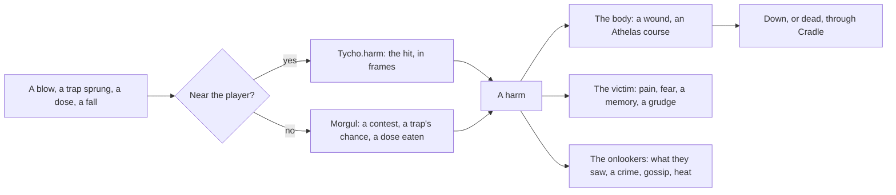

# Harm

**Partly built.** The design for people and creatures hurting each other in games on Tycho: fights, weapons, spells, traps, poison, falls, fire, and accidents nobody meant. The moment of a hit is built ([`Tycho.harm`](#tycho-the-moment), with Lodestar's fighting on it), and so is what follows ([Morgul](../tyrell/docs/modules/morgul.md) and the [larger Athelas](#athelas-grown)), and the bridge between them ([on screen and off](#on-screen-and-off)); Merryfolk's harm comes next ([the order](#the-order-to-build-it)). Its questions are settled ([what's decided](#whats-decided)).

The ideas come from Lodestar's own fighting (a hit that passes through resistances, armor, wards and statuses that react together, and hazards shown before they bite), RimWorld (wounds that need tending, infections, social fights that turn into brawls), Dwarf Fortress (grudges and vengeance that outlive the fight), Thief and Dishonored (traps and poison as the patient way to hurt someone, and accidents arranged to look like nothing), and Crusader Kings (murder by scheme, suspicion that falls on whoever had reason).

- [The idea](#the-idea)
- [A harm](#a-harm)
- [The act and the harm](#the-act-and-the-harm)
- [Tycho: the moment](#tycho-the-moment)
- [Tyrell: what follows](#tyrell-what-follows)
- [Athelas, grown](#athelas-grown)
- [On screen and off](#on-screen-and-off)
- [Each game](#each-game)
- [What's decided](#whats-decided)
- [The order to build it](#the-order-to-build-it)

## The idea

Every kind of physical harm is the same thing whatever caused it, and the work splits by how fast it happens.

- **Tycho handles the moment**, in frames: a swing's wind-up, the hit passing through the target's defenses, the knockback, the flash, the number, a trap's jaws closing on whoever stepped in. It's a part of the engine's play layer, `Tycho.harm`, and it knows nothing of minds.
- **Tyrell handles what follows**, in minutes, on screen and off: the wound and how long it takes to heal, the pain and the fear, the grudge and the revenge, who saw it, who's blamed, the watch, the gossip, the funeral. It's a new Tyrell module, Morgul (after the Morgul-blade, whose wound won't heal), on [Athelas](../tyrell/docs/modules/athelas.md), [Reverie](../tyrell/docs/modules/reverie.md), [Fellowship](../tyrell/docs/modules/fellowship.md), [Wormtongue](../tyrell/docs/modules/wormtongue.md), [Bree](../tyrell/docs/modules/bree.md) and [Cradle](../tyrell/docs/modules/cradle.md), with [the bridge](minds.md) between it and the game.
- **The game decides what harm there is**: its kinds of harm, whether anything has a health bar, which wound each harm leaves, how it looks, whether anyone can die, and whether the player can be hurt at all.

Both halves end in one record, a harm. Tycho's part makes one on screen; Morgul makes one off screen; from there on everything is shared.



## A harm

| Field | Meaning |
|---|---|
| `to` | Who it struck: a person, or `'player'` |
| `by` | Who did it: a person, `'player'`, or nobody (null: a rockfall) |
| `kind` | The game's own: `blunt`, `cut`, `burn`, `shock`, `poison`... (default: what it was done with's first kind) |
| `severity` | 0..1, how bad, on the same scale as Wormtongue's crimes: a slap 0.05, a beating 0.5, a killing blow 1. A game with a health bar gives the share of it the hit took |
| `via` | How it came: `blow`, `trap`, `dose`, `fall`, `fire`, `area`... the game's. A blow (or something thrown, shot or cast: Morgul's `direct`) is seen done; anything else leaves suspicion |
| `intent` | `meant`, `defense`, `careless` or `accident` (default `meant` if someone did it, else `accident`) |
| `cause` | The hazard it came from, if it came from one: a trap's or a taint's id |
| `what` | What it was done with: a means (a knife, a cudgel), an item, a trap's kind |
| `place` | Where (default: where the one struck is) |
| `seenBy` | Who saw it land: from the game's sight on screen (`Tycho.minds.witnesses`), everyone at the place off screen |
| `course` | The Athelas course it starts, over the wound it would leave (a dose's own) |

`world.morgul.harm(h)` takes one from the game (an input, recorded) and returns it as it stands: its `id`, the `wound` and `course` it left, whether it's `shown` yet (a dose isn't, until its course tells), and how `hurt` the one struck is now.

A health bar is one game's fast pool, not the measure of harm. The general case is the wound it leaves, a condition that runs its course, so a game with no health still has harm: a shock from a rigged machine can leave someone with shaking hands for an hour. That goes for the player too: harm to the player leaves wounds, not a health bar (Lodestar's Kindler keeps his light, which is his health already).

## The act and the harm

A fight is the plain case: the act and the harm are one moment, and anyone near sees both. Everything else puts a gap between them, and the gap is what makes blame, wrong blame, warnings and revenge possible.

| | The act | The harm | Who sees what |
|---|---|---|---|
| A fight | the blow | at once | whoever is near sees both |
| A trap | setting it, earlier | whoever trips it, later | the setting and the springing have different witnesses; it can catch the wrong person |
| Poison | dosing food or drink | a course that starts hours later | nobody sees the harm as harm: it looks like an illness until someone works it out |
| An accident | nothing, or a neglect (a rotten stair left unmended) | a fall, a fire, a machine | nobody to blame, or whoever let it happen |

So the act and the harm are two records, linked by the `cause`. Setting a trap or dosing a pot is a deed the game reports like any other (`world.sense`), seen by whoever is there then; the harm comes later and is seen by whoever is there then. Blame is a belief (Reverie's, which can be wrong): who saw the act knows; who saw only the harm suspects.

## Tycho: the moment

`Tycho.harm`, in the play layer (`src/play/harm.ts`). Like every part it's parameters, not defaults: the game passes its stages, statuses, reactions, numbers and words, and every random draw comes from the source it's given (`rng`, Lodestar's `d.rng`). It works on the game's own plain objects, by the fields the game names, so a body's statuses, a trap's state and a move's phase stay where the game keeps them and in its save as they are. Lodestar's fighting is on it, bit for bit: `test/harm.test.mjs` holds each piece to Lodestar's original code, kept in the test, and replays 478 blows on its creatures and 78 on the Kindler, recorded from Lodestar's main before it changed (`test/fixtures/lodestar-hits.json`), through Tycho's stages; Lodestar's own `test/fights.js` replays 32 fights, 23,986 frames of them, every frame's combat state hashed, unchanged.

### The hit

A pipeline of stages the game lists in order. Each is given the hit (the blow, the body, the amount as it stands) and may change the amount, stop it, mark it (a name to show), or send a blow on to another body (a shock that arcs, a chain that shares the hit), landed at once through the same pipeline or another, with the same random source.

```js
const hit = new Tycho.harm.Pipeline([
  Tycho.harm.gate((h) => !(h.to.dead || h.to.hid)),                  // out of reach: not struck
  Tycho.harm.resist({ of: elementMult, shape: crabShellShape }),      // weak, resistant or neither, by kind
  Tycho.harm.armor({ k: () => T.items.armorK, of: (b) => b.armor }),  // k / (k + armor)
  Tycho.harm.soak('ward', { first: strikeBack, gone: wardGone }),     // a shield takes it first
  affixStage,                                                         // the game's own: a shell, thorns, a chain
  Tycho.harm.react({ table: new Tycho.harm.Reactions(PAIRS), kinds: ELEMENTS, carries, do: REACT_DO }),
  landStage,                                                          // the game's: health, the number
  Tycho.harm.knock({ weight }), Tycho.harm.stagger({ ... }), Tycho.harm.hold({ ... }),
]);
const h = hit.land(foe, { by: kindler, amount: 12, kinds: ['ember'], knock: { x, y }, heavy: true }, { rng: d.rng });
// h: { amount, stopped, verdict, marks, follow, knock, stagger, flinch, hold, extra }
```

A stage is a function of the hit, or `{ name, land(h) }`. The hit (`Hit`) carries `to`, `blow` (with `amount`, `kinds`, `by`, `knock`, `heavy`, `statuses` and whatever the game's stages read), `amount`, `kinds`, `rng`, `ctx`, and what the stages made of it; `h.stop()`, `h.mark(name)` and `h.send(to, blow, pipe?)` (the blow sent on comes back as its own hit, kept in `h.follow`).

| Stock stage | What it does |
|---|---|
| `gate(open)` | Stops the blow unless `open(h)` |
| `scale(by)` | The amount times `by(h)` (an exposed foe, a brittle one, a passive) |
| `resist({ of, verdict?, weak, strong, shape? })` | The amount times `of(body, kinds)` (1 for a blow of no kind), once, after `shape(h, m)` has the last say; the verdict 'W' over `weak` (1.01), 'R' under `strong` (0.99) |
| `armor({ k, of })` | The amount times k / (k + armor); `armored(x, k, a)` is the same for a drain that isn't a blow (x × k / (k + a), as Lodestar's spores and burns take it) |
| `soak(field, { when?, first?, gone? })` | What's in the body's field (a ward) takes as much as it can; `first` as it does (what strikes it is struck back), `gone` once it's spent |
| `react({ table, kinds, carries, do, ready?, fired?, when? })` | Statuses that meet: a blow of two kinds with itself, then each of its kinds with every other kind the body `carries`, in the order of `kinds`, each reaction once; each that's `ready` runs `do[id](h)`, which returns the amount's multiplier or null (nothing to do); the amount is amount × the multipliers + `h.extra`. `Reactions` is the table: pairs by either order |
| `afflict(statuses, { of?, amount?, scale? })` | The statuses the blow leaves: its `statuses`, and `of(kind)` for each of its kinds, each by its own stacking |
| `knock({ weight?, vx?, vy? })` | The blow's knock times the body's weight, onto its knock velocity (`kvx`, `kvy`) |
| `stagger({ heavy, can?, steady?, open?, scale?, flinch? })` | A heavy blow staggers (`state` to 'stagger' for `heavy` s, times the blow's `scale` field); a body in its wind-up struck for `flinch.share` of its health breaks it off, once every `flinch.gap`; a body `steady` shrugs off both |
| `hold({ field, time, heavy?, can? })` | The struck body held still at least `time` s (`heavy` for a heavy blow) |

Lodestar's two pipelines are `KINDLER_HIT` (`hurtPlayer`: his gate, his thick skin as `scale`, the lattice's armor, his ward's `soak` with the strike back, then the light knocked out of him) and `FOE_HIT` (`hurtEnemy`: the gate; exposed; the nature and a Slag Crab's shell as `resist`; Wick's note; brittle; its affixes, a Keeper's phase, the reactions on `react` with its own `REACT_DO`; the statuses its elements leave; a warded shell cracked; a cast ward's `soak`; the health, its flash and the number; `knock`, `stagger` and `hold`; the wake and the Kindler's traits, the kill). Its affixes' thorns and chain are blows sent on, through `KINDLER_HIT` and a pipeline of one stage (`CHAIN_SHARE`); its reactions' and procs' arcs through `FOE_HIT`.

### Means: weapons, spells, poisons, traps

What harm is done with is declared once, as a means, and the player and the characters wield the same ones.

```js
const MEANS = Tycho.harm.means([
  { id: 'cudgel', kinds: ['blunt'], use: 'strike', severity: 0.2,
    move: { windup: 0.35, active: 0.1, recover: 0.45, area: { touch: 2 } }, blow: { amount: 8, knock: { x: 120, y: 0 } } },
  { id: 'arc', kinds: ['shock'], use: 'cast', cost: { cooldown: 0.6, charge: 2 }, severity: 0.15, blow: { amount: 6, statuses: ['shock'] } },
  { id: 'nightshade', kinds: ['poison'], use: 'dose', course: 'nightshade' },
  { id: 'venom', kinds: ['poison'], use: 'coat', uses: 3, blow: { statuses: ['poison'] } },
  { id: 'snare', kinds: ['cut'], use: 'set', severity: 0.25, trigger: { zone: { w: 12, h: 4 }, once: true, hidden: true }, blow: { amount: 5 } },
]);
MEANS.get('arc'); MEANS.of('cast');
```

A means is used one of a few ways: **`strike`** (a move up close), **`throw`** and **`shoot`** (a projectile), **`cast`** (a spell, a move with a cost: a cooldown, a charge, or a pool the game names), **`coat`** (onto another means, so its blows carry this one for `uses` blows), **`dose`** (into food or drink, a [taint](#poison)), **`set`** (a [trap](#traps), a trigger here and a hazard in Morgul). Its fields are the shared definition: Morgul reads `id`, `kinds`, `use`, `severity` and `course` off screen; Tycho plays `move` (a [Move](#moves)), `blow`, `trigger` (a [Trigger](#triggers)) and `cost` on screen.

| Helper | |
|---|---|
| `means(list)` | A lookup (`Arsenal`): `get(id)`, `has(id)`, `of(use)`, `list` |
| `cooldown(m, step?)` | Its cooldown: the cost's, or a combo's step's (by step, round) |
| `costOf(m)` | What it costs in charge, or from its pool |
| `ready(holder)`, `use(m, holder, { step, scale, pools })` | A holder (`{ cd, charge }`) ready when its cooldown is out; using it pays the cost (charge from the holder, or `cost.amount` from `pools[cost.pool]`) and starts its cooldown, or does nothing and says false |
| `coat(holder, m, uses?)`, `coatOf(holder)`, `spendCoat(holder)` | A coat on what a holder wields, its uses spent a blow at a time |

The player wields a means as gear (`Tycho.items`: a thing in a slot, with the means as its own), or the game's own way; a character holds it as a Ceres good of the same id. Lodestar's Forms are its means (`SPELL_MEANS`: each Form and the spark a cast, its cooldown, an Arc's one a step of its combo, and its charge): `spellWait` and `groupCost` read them. A cast there costs nothing but its cooldown, and its wait is the means' cooldown times Quicken, the frame and the wrist in its own order, so it doesn't go through `use`.

### Statuses

What a hit leaves on a body for a while, declared with where the body keeps it, how long it lasts, how often it bites, how it stacks, how it wears off and how it spreads. A **timer** is a number on the body, its time left (a chill, an element's mark); a **dose** is an object, `{ t, its amount a second (its dose field), n stacks, tick }`, that bites while it lasts (a burn, a poison).

```js
const S = new Tycho.harm.Statuses([
  { id: 'frost', at: ['st', 'frost'], time: 3, wear: 'clear', ends: (e) => { if (e.stk) e.stk.frost = 0; } },
  { id: 'chill', at: 'slowT', time: 2, wear: 'clamp' },
  { id: 'burn', dose: 'dps', time: 3, every: 0.5, stack: 'add', most: 3, spread: { r: 32 } },
  { id: 'poison', at: 'blight', dose: 'dps', time: 4, every: 0.5, stack: 'refresh', spread: { r: 40, on: 'death', reach: 'middle' } },
  { id: 'shockStack', at: ['stk', 'shock'], stack: 'count', most: 5 },
]);
S.give(e, 'burn', { amount: 2, scale: k });   // 'new' | 'again' | 'most' | 'full' | 'kept'
S.wear(e, dt);                                // timers, each by its wear
S.tick(e, dt, { bites, bite, show, after });  // doses: time out, bites, beats, gone
S.spread(e, 'poison', foes, { who, take, as });
```

| | |
|---|---|
| `at` | Where the body keeps it: a field (by default the id), or a field's key (`['st', 'frost']`, the map made when first given) |
| `time`, `every`, `bite` | How long one lasts; its beat (a dose shows a number each beat); a dose bites `steady` (amount × dt every step, Lodestar's) or on its `beat` (amount × every) |
| `stack` | Given again while it lasts: `max` (the longer time), `set` (the time given), `count` (one more, or n, back to none and 'full' at `most`), `add` (a dose: one more stack to `most`, the amount added to `most` times one, the longer time; 'most' when it's there), `refresh` (a dose: a fresh one, the larger amount), `keep` |
| `wear` | A timer: `clamp` (down to 0 every step), `clear` (down while above 0, and at 0 `ends`), `down` (down while above 0, past 0) |
| `spread` | Its reach for `spread(from, id, to, o)`: within `r` of the body, to the other's edge (r + its r) or its middle; `who` may catch it, `take` agrees (a weaker one, or none), `as` makes what it gets (else a copy); `died(body, to)` spreads what spreads `on: 'death'` |
| `get`, `has`, `put`, `clear`, `def` | Its time or dose; carried (a timer above 0, a dose there); put as given; gone (0, or null) |

Two statuses that meet react through the `react` stage and its `Reactions` table. Lodestar's are `FOE_STATUS` (each element's mark, the chill, a burn that stacks to the Inferno's most, a poison that takes the stronger, the brittle, the frozen, a heavy blow ringing, a stun and a loss worn by the creature's own step, the stacks of shock and chill that overload and freeze) and `KINDLER_STATUS` (his chill, jolt, burn and blight); its five elements' eight reactions are its `REACT_DO` on `react`, and the rules for what each element leaves (a shock's chance to arc, frost not stacking while frozen, a burn at its most and a poison on the poisoned spreading at once, a second heavy Force blow stunning) are its own stage over `FOE_STATUS`.

### Moves

An attack is a timeline: a wind-up (the tell), the strike (the frames it can hit, and the area it covers), the recovery (the opening), each phase's name and time in the body's own fields.

```js
const LUNGE = new Tycho.harm.Move({ windup: () => def.windup, active: () => def.lungeTime, recover: () => def.recover,
  names: { active: 'lunge' }, once: 'hitDone', area: { touch: 3 } });
LUNGE.start(e);                                    // e.state 'windup', e.t its time
if (e.t <= 0) LUNGE.next(e);                       // on to 'lunge' (struck cleared), 'recover', then null: what next is the game's
if (LUNGE.hits(e, p, p.x, p.y, p.r)) hurt(p);      // in its area and not struck yet this swing
```

The game counts the time down and says when to go on. A move's struck targets are one field (`once`, for one target) or a list on the body. `reaches(area, x, y, r, dx, dy, tx, ty, tr)` is its area alone: `touch` (within both radii and this much more), `r` (round, to the other's edge), `ahead` with `w` (a line along the aim, by `segDist`), or `r` with `cos` (a cone, or as near as `close`). A solid hit during a wind-up breaks it off, a heavy one staggers, and a body marked steady shrugs both off: the `stagger` stage. Lodestar's creatures' attacks are moves (`foeMove`: a lunge for the crawler, the dropper, the crab, the idol and the eel; a charge for the construct, the warden, the Keepers, the tusker and the hound; the sentinel's sweep; a wind-up alone that ends in the kind's own strike, its reach asked with `reaches`, for the wisp, the plants, the skink, the wraith, the lurker's lash, the weaver and the dropper's fall).

### Triggers

Harm that waits in space: a trap, a vent, a cloud. A trigger's kind has a zone, what sets it off (a body entering, or a cycle that shows before it bites, or a mark shown before it bites once), whether it goes off once, whether it's hidden, and the blow it lands; a placed one is the game's own object (`{ x, y, ph, t, by, armed, sprung, fired, last, done }`).

```js
const VENT = new Tycho.harm.Trigger({ cycle: { every: 5, tell: 1.2, bite: 0.6 }, zone: { r: 11 } });
if (VENT.fires(v, clock)) for (const b of bodies) if (VENT.inside(v, b.x, b.y, b.r)) hurt(b);   // once a cycle
VENT.phase(VENT.at(clock, v.ph));                  // 'rest' | 'tell' | 'bite', for drawing it
const STRIKE = new Tycho.harm.Trigger({ tell: 1.1, zone: { r: 20 }, once: true });
if (STRIKE.down(strike, dt)) ...                   // a mark: its tell run out
```

| | |
|---|---|
| Zones, `inZone(z, cx, cy, x, y, r)` | `{ r }` round its place; a box, `{ w, h }` on its place or `{ x0, y0, x1, y1 }`, felt as Tycho.collide feels a round body against a box; a line, `{ x0, y0, x1, y1, w }`; tiles, `{ tiles(x, y) }` |
| `at`, `share`, `phase` | Seconds into its cycle, or the share, from its offset `ph` (an `every` of the placed one's own may be passed); resting, telling or biting |
| `fires(p, clock)`, `wraps(p, clock)` | The step its bite begins, once a cycle (`fired`); the step its cycle begins again (`last`) |
| `down(p, dt)`, `goes(p)` | A mark's tell counted down, true once it's out; true once, the first time it's out (`done`) |
| `inside(p, x, y, r)`, `spring(p, by?)` | A round body in its zone; set off (false if disarmed, or sprung and set off only once) |
| `beat(s, dt, every?)` | A zone's beat: true on the step its tick runs out (a field that bites what's in it every half second) |
| `Traps(box)` | Traps in a world of boxes, each one's box in a Tycho.collide space: `add`, `remove`, `entered(x0, y0, x1, y1)`, the first armed one a body's box overlaps |

Lodestar's vents (they glow, then burst once a cycle) and spore pods (they swell, then let a cloud go as the cycle begins again) are triggers, its clouds and the ground that bites (spores, fire, chilling ground, the Kindler's lingering fields on their beat) zones, and the Lodestorm's strike, a blinker's landing and a volatile elite's blast marks; a mortar's landing and a snare's line are zones too.

### The player's wounds

The player isn't one of Tyrell's people (to Tyrell the player is `'player'`, someone who does things), so Athelas doesn't hold the player's wounds: `Tycho.harm` does, as conditions that run on the game's clock in game minutes, in phases shaped like Athelas's (sore for an hour, then stiff for a day), so one wound table can declare both.

```js
const WOUNDS = new Tycho.harm.Wounds([
  { id: 'sprain', phases: [{ id: 'sore', minutes: 60, has: ['limping'] }, { id: 'stiff', minutes: [600, 900] }], again: 'extend' },
  { id: 'shock', phases: [{ id: 'shaky', minutes: [20, 40], has: ['shaky'] }] },
]);
Game.s.wounds = WOUNDS.fresh(now);           // { now, on: { sprain: { p, since, until } } }: plain JSON, in the game's save
WOUNDS.give(Game.s.wounds, 'sprain', rng);
WOUNDS.step(Game.s.wounds, minutes, rng);    // [{ id, phase, healed, at }]: phases ending in time order, the last healing it
WOUNDS.has(Game.s.wounds, 'shaky');          // a wound, a phase or a mark: bench work rougher, the stick slower
```

A phase lasts `minutes` or `[min, max]` drawn from the rng the game passes; given again, a wound is ignored, runs its phase on as long again (`extend`), or starts over (`restart`). `of(s)` lists what's open with the minutes left, `heal(s, id?)` ends one or all. At its worst the player is knocked down, and the game says what that costs (time, money, what they were carrying); the player never dies of harm unless a game allows it. Lodestar doesn't use it: its Kindler's light is his health.

### The feel

The world holds still a moment as a hit lands (longer for the one struck, longer for a heavy hit); knockback scaled by each body's own weight; a flash; the number rising; a shake for games that want one.

| | |
|---|---|
| `Hitstop({ state, gap, clock })` | The world held still: `freeze(t, heavy)` at least t s, unless the last began within `gap` s (only a heavy hit freezes again so soon); `hold(dt)` each step says whether it's still held. On the game's object (`hitstop`, `frozeAt`: Lodestar's `Game`) |
| `hold` stage | The one struck held still longer |
| `knock` stage, `Knock({ decay })` | The knock by the body's weight; it moves the body while it's over `min` (1), fading by e^(-decay × dt): `step(body, dt, move)`, `fade(dt)`, `stop(body)` |
| `flash(body, t, { col })`, `fade(body, dt)` | A flash's time (and its color, as given), fading to 0 |
| `rise(list, dt, speed)` | Numbers and words rising and running out (Tycho.fx's `tick`) |
| `Shake(state, decay)` | `kick(n)`, `step(dt)` |

### Lodestar on it, and what stayed its own

What's Tycho's in Lodestar now: the two pipelines and their stock stages, the hold still, the knock, the flashes, the numbers rising, the shake, every status and its wearing, biting and spreading, the reactions' table and stage, the creatures' moves, the vents, pods, clouds, marks and biting ground, and the spells' cooldowns and charges. What stayed its own, as stages and calls on Tycho's parts, because it's this game's and nothing general: its affixes, a Keeper's phases, what each element leaves (above), the number and its WEAK and RESIST, the wake and the Kindler's traits; a kill's loot and motes; the spells' shapes and their hit (`circuitHit`: crits, the ore's weight, the charge given back, a Chain's leaps), what's in flight and what lingers; the lava and the water, which are its floor's own map of hazards (`hazardAt`), read once a step for several things; and its creatures' own strikes (a skink bursting up, a tusker's slide, a hound's glances).

## Tyrell: what follows

Morgul, a Tyrell module, built: [morgul.md](../tyrell/docs/modules/morgul.md) has all of it, and [Athelas](../tyrell/docs/modules/athelas.md) grew what wounds and poison need ([below](#athelas-grown)). It's inert until the game declares a means, a wound or a trap: a world with no harm saves and hashes as if Morgul were off. All its state is plain JSON in `world.s.mod.morgul`; everything from outside is an input, so time walk records it, and a poisoning rewinds like anything else. Off screen it draws from a stream of its own, so people's own draws stay as they were.

### Means and wounds

The means are declared once and shared with `Tycho.harm` (Morgul reads `id`, `kinds`, `use`, `severity`, `course`, and keeps the rest); a character holds one as a Ceres good of the same id. The game maps harm to wounds: by kind, by how severe, by what it was done with and how it came, the first that fits.

```js
const M = world.morgul;
M.means({ id: 'cudgel', kinds: ['blunt'], use: 'strike', severity: 0.2 });
M.means({ id: 'nightshade', kinds: ['poison'], use: 'dose', course: 'nightshade', severity: 0.45 });
M.wound({ id: 'bruised', kinds: ['blunt'], at: [0, 0.3], course: 'bruised' });
M.wound({ id: 'beaten', kinds: ['blunt'], at: [0.3, 1], course: 'beaten' });
M.wound({ id: 'cut', kinds: ['cut'], course: 'cut' });   // festers if nobody tends it: the course's branches
```

A wound is an Athelas course afflicted at the harm's severity: it runs its phases (sore, then stiff, then healed), changes what they need and can do while it lasts, and heals in its own time (faster or slower by the `healing` knob). Someone's `hurt` is the sum of their open wounds' severities, each by its phase's `hurts` (1 at first, less as it heals), so it eases as each heals; with `again: 'worsen'` two beatings in a day are worse than one.

### Down and dead

At `downAt` (0.8) hurt they go down: they stop (and leave any exchange), lie there (the down action, above everything, everything else ruled out), and come round after a while, or sooner when someone helps them up (the `tend` effect). At `killAt` (1) they may die, with `deathChance` times the `lethality` knob (0 by default: nobody dies of harm unless the game says so): a departure through Cradle (`'killed'`), with grief for those who loved them, inheritance, the game's crime for a killing to whoever saw it, and the one who did it remembered by whoever knew them and believes it. Without Cradle nobody dies. A wound's phase that ends in death (a cut gone bad) kills only as often as lethality says, and otherwise they pull through.

### The victim

- **Feelings**, through Reverie: `in_pain`; `furious` or `scared`, by their temper and nerve; `shaken` after a bad one.
- **A memory** of it, as important as it was severe, about who did it if they know.
- **What they believe**: who did it, as seen if it was done to their face (a blow), else suspected (below).
- **A grudge** against whoever did it, through Bree, by the severity and the intent's share (`intents`: meant 1, careless 0.4, accident 0.1, defense 0), so none for a blow struck back in a fight they started. Meant harm between two households can set them feuding (`feud`, off by default).
- **What they hold against them** (`hurt_by`), fading by their forgiveness: revenge grows from it.
- **Fear of them**, more for the timid, fading by their courage: they keep away, want to leave when they're about, and fight back less.
- **Fear of the place**: a place where they were hurt, or where they believe a trap or a taint is, weighs less for a while (the `caution` knob).
- **Less regard**, and a note in their file (`file:<who>.harmed`).

### Onlookers and the law

Whoever saw it believes it (`did:<who>:harm`), remembers it, thinks less of whoever did it. A harm the game declares a crime (`crimes: { meant: 'assault', careless: 'negligence', killed: 'murder' }`) goes to Wormtongue with the harm's own severity (a stimulus can carry one now): reports to the watch, heat for the player, infamy, and gossip that carries it to people who never saw it. Self-defense is never a crime. Blows in a fight are Bree's to witness. Onlookers don't step in on their own outside a fight (the game's on-screen choice, or Bree's stepping in).

### Traps

```js
M.trap({ id: 'snare', kind: 'cut', severity: 0.25, hidden: true, uses: 1, catch: 0.3 });
world.action({ id: 'set_snare', at: 'tag:path', minutes: 20, tags: ['harm'], if: ['has:snare'], then: ['take:snare', 'set:snare'] });
world.morgul.set('snare', { by: 'pip', place: 'barn', for: 'tomas' });   // the game's own (the player's), recorded
```

`set:<trap>` sets one where they are, with them as its setter and the action's target (a plan's target) as who it's for. Off screen, whenever someone starts something at its place, it may catch them, with its `catch` chance (less for someone careful, less for one in plain sight, never for someone who knows it's there); one set for someone catches only them. Whoever saw it set knows it's there (`trap:<id>`) and who set it (`set:<id>`): they steer clear, warn whoever it's for if they like them (`warnAt`), disarm it (the `disarm` effect), or keep quiet; gossip carries it. On screen the game draws it as a trigger and reports when it springs (`morgul.spring`); the regions the game says are near (`morgul.near`, by default the regions in focus) are left to it, so nobody is caught twice. It's an input rather than a read of the focus, so a rewind replays it as it was.

### Poison

```js
M.taint({ place: 'stall', item: 'noodles', n: 3, course: 'nightshade', by: 'vey' });
world.action({ id: 'spike', target: 'person', at: 'cafe', if: ['has:nightshade'], then: ['take:nightshade', 'taint:nightshade'] });
```

A taint goes into a place's stock of a good, a place's pot (whatever's eaten there next), or someone's goods. Tainted servings travel with the goods: bought, they go home with the buyer (their household's pantry keeps the count); used or eaten on the spot, each serving is tainted with the chance of what's left, and whoever gets one has a harm (`via: 'dose'`) that starts the course. The poison's course starts quiet (a phase nobody notices, not even the one eating), then shows (a phase that `tells`), and that's when the questions start. A poisoner can aim at one person (`for`: the meal they'll eat), or not care who. Whoever saw it dosed knows who did it, and won't eat there.

### Suspicion

When a harm is seen done, whoever saw it knows who did it. When it isn't (a trap sprung, a poison that tells), the victim and whoever saw them struck down may suspect someone: whoever saw it set or dosed knows; anyone else, by chance (`suspect` times the `suspicion` knob), draws a suspect by the evidence: being told who set or dosed it, having served it (the place's owner, staff on shift), a grudge against the victim (Bree's `animosity`), being about when it was done or when it struck; weighed up by dislike and down by liking. Each is a belief (`did:<suspect>:harm`), as strong as the evidence, and it can be wrong: a scapegoat is blamed, feared and hated for a harm someone else did, and gossip spreads the wrong name as readily as the right one. Nobody investigates: suspicion is all there is, and working out the truth is the player's to do.

### Fights by numbers

A Bree fight (a kind in `fights`) comes out by a contest, wherever it is. Both fighters are held in it (the fighting action) until it's over. Each turn one of them lands a blow, by the odds of their `might` (the game's considerations: strength, size, skill, nerve), what they hold (a means, by its `severity`), and how hurt each already is; the blow's severity is a fist's plus the means', give or take. The one who started it strikes meant blows, the other strikes back in defense. A fight ends as Bree's do, by someone stepping in, or someone walking off (the more readily the nearer they are to yielding), and two more ways: someone yields (hurt past `yieldAt`, sooner for the timid), or someone goes down. Each blow is a harm, and each `bree:turn` carries it (`turn.harm`), so the game can show a scuffle in step.

### Fights with the player

Harm by `'player'` (or to the player by a character) face to face, not by a trap or a dose, makes the character answer, as the fight starts and after each harm between them: fight back, flee, yield or call for help, drawn by their nerve and temper, how hurt they are, their odds against the player (whose might is the game's fact, `might:player`), and whether a friend is about. It's emitted as `morgul:respond`; `respond(id)` asks without changing anything. One who flees wants to get away a while.

### Choosing harm

Harm is chosen like anything else. The game declares the actions (attacking, ambushing, setting a trap, poisoning, fleeing, hiding, tending the hurt, calling the watch) and Morgul adds what to weigh them by:

- terms: `hurt`, `wounded:<kind>`, `hurt_by:<id>`, `afraid_of:<id>`, `danger` (here, or a place), `armed`, `odds:<id>` (a look at how a fight with them would go), `suspects:<id>`, `down`, `vengeance:<id>`, `fleeing`;
- violence: actions tagged `harm` weigh by the `violence` knob (0: nobody ever does harm);
- revenge as a Mentat task: what someone holds against whoever hurt them, past `vengeAt` (times `vengeance` and their temper), makes the game's `avenge` task an option aimed at them, its methods planned like any other (Mentat tasks can be aimed at someone now: `target: 'person'`); harm done to them sates it;
- flight: someone who fears a person at the same place, with poor odds against them, wants to leave (options there weigh less, fleeing more, and they think again as they meet);
- caution: a place they know is dangerous weighs less;
- care: someone who likes a hurt person tends them (an action tagged `care`; the `tend` effect: Athelas's mark that keeps a cut from festering, the better for skill, and up if they're down).

Gaff, the director, can pace it, so violence is an event when it comes, not the weather: Rocinante's brawl at the Belt is a storylet.

### The dials

Headline knobs, as everywhere in Tyrell: the world's, times each person's own `tune`:

| Knob | Default | Meaning |
|---|---|---|
| `violence` | 1 | How readily anyone chooses an action tagged `harm`; 0: nobody ever does |
| `lethality` | 0 | How often harm at its worst kills; 0: nobody dies of harm |
| `vengeance` | 1 | How strongly harm turns into a wish for revenge |
| `caution` | 1 | How much people steer clear of danger they know of |
| `healing` | 1 | How fast wounds heal |
| `suspicion` | 1 | How readily people suspect, and how strongly |

Every finer number is a setting too ([Tuning](../tyrell/docs/tuning.md#morgul)).

### The API

| Method | | |
|---|---|---|
| `means(def)` | definition | What harm is done with, as [above](#means-weapons-spells-poisons-traps): its kinds, use, `severity`, `course` (the bridge's `means` declares it here and to Tycho at once) |
| `wound(def)` | definition | A harm's kind, severity band, what and how, and the course it leaves |
| `trap(def)` | definition | A kind of trap: its harm, `hidden`, `uses`, `catch` |
| `harm(h)` | **input** | A harm, from the game (on screen); returns it |
| `set(kind, { by, place, for, seenBy })` | **input** | A trap set, from the game |
| `spring(trap, id)` | **input** | A trap caught someone on screen, or the player |
| `disarm(trap, by)` | **input** | |
| `taint(def)` | **input** | Poison into stock, a pot, or someone's goods |
| `tend(id, by)` | **input** | Someone tends someone: their wounds, and up if down |
| `near(regions)` | **input** | The regions whose traps the game springs (the regions in focus, by default) |
| `hurt(id)`, `wounds(id)`, `isDown(id)` | look | |
| `traps(place?)`, `taints(place?)`, `harms(id?)` | look | |
| `odds(a, b)`, `might(id)` | look | How a fight between them would go |
| `respond(id)` | look | How someone would answer a fight with the player |
| `applyHarm(h)`... | engine | The versions code inside the simulation calls |

Effects: `harm:<kind>=<severity>` (to the context's target), `set:<trap>`, `taint:<course>`, `disarm`, `tend`. Events: `morgul:harm`, `morgul:down`, `morgul:up`, `morgul:killed`, `morgul:set`, `morgul:sprung`, `morgul:disarmed`, `morgul:tainted`, `morgul:suspect`, `morgul:respond`; Bree's `bree:turn` with each blow.

## Athelas, grown

Wounds and poisons need a little more of Athelas than colds and ale do, and it has it now, all opt-in (a course without these runs as it always did, and every recorded hash is unchanged):

- **Severity**: `afflict(id, course, from, severity)` (and `afflict:<course>=<severity>`) gives an affliction how bad it is, 0..1. A course is written for `sevAt` (0.5); a phase lasts `sevStretch ^ ((severity - sevAt) × 2)` times as long (2: twice at 1, half at 0), and its rates and weights are raised to the power `1 + sevDepth × (severity - sevAt) / sevAt` (twice as deep at 1, nothing at 0). A course can say its own (`severity: { at, stretch, depth }`). `sev:<course>` reads it.
- **Worsening**: `again: 'worsen'`, so a second beating adds to the first (up to 1), the phase it's in running as long as it would at the new severity.
- **Branches**: a phase's `next` is a phase's id, `null`, or `[{ if: [...], to }]`, the first that holds, so a tended cut heals and an untended one festers.
- **Care**: `athelas.tend(id, course, by)` and the `tend` effect leave a mark of how well (`tendBase`, the rest by the tender's `tendSkill`) that the branches read (`tended:<course>`), and bring the phase's end sooner (`tendHasten`).
- **Ending badly**: a phase with `dies` ends in death through Cradle as it runs out (a wound's only as often as Morgul's lethality says); without Cradle, or spared, they pull through to its `next`.
- **Quiet phases**: a phase nobody notices (`quiet`: no feeling, and `under:` reads nothing, while its rates and weights work), and one that `tells` (the `shows` event), so feelings, onlookers and suspicion start when the harm shows and not before.

## On screen and off

Tyrell has no coordinates, so off screen Morgul settles harm by numbers: a fight by its contest, a trap by its chance, a poison by who eats. On screen the game plays it out with `Tycho.harm` and reports each harm (`morgul.harm`) and each trap sprung (`morgul.spring`). The bridge does the handing over, the way Tyrell already hands bodies to the game near the player ([Harm in the bridge](minds.md#harm)):

- `Tycho.minds.means(world, list, Tycho.harm.means)` declares the means to both sides at once (a means set as a trap as Morgul's trap too) and returns Tycho's arsenal; `Tycho.minds.harm(world, hit, { whole, people, sight })` turns a hit Tycho landed into a harm: the bodies' ids, its kind, its severity as the hit's share of what the game measures, what it was done with, and its witnesses.
- A fight between characters goes on by numbers wherever it is. Near the player the game shows it as a scuffle: `Tycho.minds.scuffles(world)` gives it the beats in step with Bree's turns (they square up; each turn who swings at whom, whether it lands or the other counters, how hard; how it ends) and the fights going on as the world has them, so a rewind leaves nothing stale.
- A fight with the player in it is played in frames: the player's strikes, casts and throws through `Tycho.harm`, and the character's back with the moves of what they hold (fists, if nothing). Whether they fight back, flee, yield or call for help is Tyrell's choice, made as the fight starts and after each blow; `Tycho.minds.fighters(world, { might })` makes each answer into what the game's fighter does, with what they'd fight with, and sets the player's might, the game's, as the fact Morgul reads.
- A trap at a place near the player is left to the game's trigger, so nobody is caught twice: `Tycho.minds.traps(world, { regions, make, drop })` tells Morgul which regions are loaded, hands the game the traps there to make triggers from (and takes them back when they're spent or far), and reports a trigger that springs, on a character or the player.

Lodestar's creatures stay frame brains in the game, not Tyrell minds; only people get the whole chain.

## Each game

- **Lodestar**: `Tycho.harm` only. Its fighting moves in as it is: natures, armor, wards, affixes, statuses and reactions, the foes' moves, its spells as means cast from the rig, its hazards as triggers, the freeze and the knockback. The Kindler's light stays its own pool and health, and its creatures die as they do now. Nothing changes in play.
- **Merryfolk**: three things, and nobody dies of any of them.
  - **Scuffles**: a quarrel that turns physical (Bree's argument escalating to a fight) leaves a bruise or a bloody nose, settled by numbers and shown as a tussle.
  - **Mischief and pranks**: a tripwire across a path, a snare by the hedge, a bad mushroom slipped into a stew: traps and taints that sting, embarrass and start grudges, set by folk with a grudge or a wicked streak.
  - **Its body on Athelas**: its ale, germs and toxins, now its own body chemistry, move onto Athelas courses, held to its season's numbers before and after (`test/season.js`), as the minds' move was.
- **The White Dragon**: nothing for now. Its design keeps no fighting and no health.

## What's decided

Settled on 2026-10-28:

1. **Nobody dies of harm** in Merryfolk or the White Dragon: `lethality` starts at 0 and both leave it there, so harm at its worst knocks someone down. Lodestar's creatures die as they do now. The engine can still kill for a game that raises it.
2. **The player can be hurt, by wounds, with no health bar**: conditions that slow them for a while ([the player's wounds](#the-players-wounds)). Lodestar's Kindler keeps his light.
3. **Fights between characters are settled by numbers** and shown as a scuffle, on screen and off. A fight with the player in it is played in frames.
4. **Suspicion only**: unseen harm leaves beliefs about who did it, which can be wrong; nobody investigates, and the truth is the player's to work out.
5. **The player and the characters wield the same means**: weapons, spells, poisons and traps, declared once; the player holds them as gear, the characters as goods.
6. **The module is Morgul.**
7. **The White Dragon gets nothing for now**; **Merryfolk gets scuffles, mischief and pranks, and its ale, germs and toxins on Athelas**.

## The order to build it

1. **Built: `Tycho.harm` from Lodestar**, bit for bit: the pipeline, statuses and reactions, means (its spells first), moves, triggers from its hazards, the feel; then the player's wounds, which Lodestar doesn't use. Lodestar's traces and a new test that replays recorded hits against its `hurtEnemy` hold it.
2. **Built: Athelas grown**: severity, worsening, branches, care, ending badly, quiet phases.
3. **Built: Morgul**: harm, wounds, down and dead, the victim, the onlookers and the law, traps, poison, suspicion, fights by numbers, the knobs; in Rocinante a brawl at the bar, a snare in the barn and a poisoned stew, and a Voight-Kampff check that nobody dies with `lethality` 0, grudges follow harm, and the poisoner is suspected some of the time and not always.
4. **Built: the bridge**: `Tycho.minds.means` and `harm`, the scuffle shown in step with its turns (`scuffles`), fights with the player played in frames (`fighters`), and traps handed between near and far (`traps`), held by `test/minds-harm.test.mjs` against Tyrell and Tycho.harm together.
5. **Built: Lodestar** onto `Tycho.harm` (in step 1, as its proof), held to a test of 32 fights recorded before the move, frame for frame.
6. **Then Merryfolk**: its ale, germs and toxins onto Athelas first, held to its season's numbers; then scuffles from its quarrels; then mischief and pranks.
